# Seedling governance: one-page map

Three connected systems take every change from a local edit to a crates.io
release, and leave a record at each step.

| # | System | What it does | Where it lives | Where it runs |
|---|---|---|---|---|
| 1 | **Local change monitor** | Gates commits that touch code, stamps trailers, rebuilds the audit log | `tools/hooks/`, `tools/githooks.py`, `tools/audit.py`, `governance/audit/` | Development environment / Scott Lingley's machine (git hooks) |
| 2 | **Security gate** (testing manager) | 15 scored checks + 2 informational, weighted score, threshold 95, critical checks | `security/gate.py`, `security/reports/`, `security/WORKS_CITED.md` | Hooks (fast), GitHub Actions (full) |
| 3 | **Change manager** | CI with sticky PR score, tag-driven release to crates.io + GitHub Release, daily tracker | `.github/`, `tools/exec_summary.py`, `tools/tracker.py`, `tools/release_check.py` | GitHub Actions |

All settings: `governance/config.toml`, read by every script.

## Flow

```mermaid
flowchart LR
  A[Edit src/, web/, build.py] --> B{git commit}
  B -->|pre-commit: gated paths staged| C[gate.py --hook<br/>fast: clippy x4, unsafe, imports,<br/>CSP, 50k-frame fuzz]
  C -->|fail| X[Commit blocked<br/>bypass: SEEDLING_SKIP_GATE=1, logged]
  C -->|pass| D[commit-msg: Security-Gate,<br/>Co-Authored-By, Claude-Session trailers]
  B -->|no gated paths| D
  D --> E[post-commit: audit.py rebuild<br/>governance/audit/*]
  E --> F[git push / pull request]
  F --> G[ci.yml: gate.py --full<br/>1M-frame fuzz + browser/CSP probes]
  G --> H[Reports artifact + sticky PR comment]
  H --> I[Merge to main]
  I --> J[git tag vX.Y.Z && git push --tags]
  J --> K[release.yml: tag == crate version,<br/>gate must pass >= 95]
  K --> L[exec_summary + changelog + audit entries]
  L --> M[crates.io via Trusted Publishing<br/>OIDC, no stored token]
  M --> N[GitHub Release:<br/>seedling.html + security report]
  O[tracker.yml daily 13:17 UTC] --> P[pinned status issue +<br/>TRACKER.md run artifact]
```

## What runs where

| Where | What |
|---|---|
| **This development sandbox** | Hooks (installed), fast gate on commits, full gate on demand with `SEEDLING_BUILD_STD=1` (no downloadable wasm32 std here), `tracker.py --dry-run`, `exec_summary.py`. No network access to GitHub or crates.io. |
| **Scott Lingley's machine** | Same hooks after `sh tools/install-hooks.sh` (plain `rustup target add wasm32-unknown-unknown`, no build-std). The first `cargo publish`, creating tags. |
| **GitHub Actions** | `ci.yml` (every push/PR), `release.yml` (tags `v*.*.*`, or manual dry run), `tracker.yml` (daily + manual). |

## Records produced

- **Commit trailers**: `Security-Gate:` (score of the exact tree committed, or `BYPASSED`), `Co-Authored-By:`, `Claude-Session:`.
- **Audit log**: `governance/audit/AUDIT_LOG.md` + `audit_log.jsonl`, a deterministic function of git history (`python3 tools/audit.py rebuild`); complete up to the commit before the one containing it, because hooks never create commits.
- **Gate reports**: `security/reports/latest.{md,json}` and `history/` copies by commit SHA / tree (local, git-ignored); CI artifact `security-reports-<sha>`; attached to every GitHub Release.
- **Release notes**: executive summary (what changed for users, score delta, risks), changelog section, audit entries since the last tag.
- **Tracker**: the pinned issue "Project status & tracker", plus `TRACKER.md` and `tracker.json` attached to each Tracker run (kept 90 days). It never commits to `main`.

## Manual steps for Scott Lingley (cannot be done from here)

1. **Create the GitHub repository** `lingles-ASIF/seedling` (empty: no README, license or .gitignore, since the project already has them). The slug is already set in `governance/config.toml`, `.github/CODEOWNERS`, `.github/ISSUE_TEMPLATE/config.yml` and `Cargo.toml`; if you choose a different name, change those four.
2. **Sponsorships (optional)**: set up a GitHub Sponsors profile at https://github.com/sponsors, and once it is live, uncomment the `github:` line in `.github/FUNDING.yml` and the "Support Seedling" section at the end of `README.md`. Until then both stay hidden so nothing links to a page that does not exist.
3. **Push**: `git remote add origin ...; git push -u origin main`. Check that the CI run passes.
4. **Enable private vulnerability reporting**: Settings > Advanced Security > Private vulnerability reporting > Enable.
5. **First crates.io release by hand** (Trusted Publishing cannot create a crate):
   `cargo login` (token from crates.io account settings), then
   `python3 security/gate.py --full` (must PASS), then `cargo publish -p seedling --target wasm32-unknown-unknown`.
   Do **not** push a `v0.1.0` tag afterwards (the workflow would try to publish 0.1.0 again and fail); the first
   automated release is the next version. Optionally create the 0.1.0 GitHub Release by hand.
6. **Configure Trusted Publishing** on crates.io: crate > Settings > Trusted Publishing > Add GitHub publisher: owner = your user, repository = `seedling`, workflow filename = `release.yml`, environment = `release`. Then revoke the API token used in step 5.
7. **Optional hardening**: in GitHub, add required reviewers to the `release` environment; protect `main` (require the CI check); pin actions to commit SHAs.
8. **Pin the status issue** once `tracker.yml` has created it (Actions > Tracker > Run workflow); the workflow also tries to pin it via the API.
9. **Every later release**: bump `version` in `Cargo.toml`, move `[Unreleased]` in `CHANGELOG.md` under the new version (draft with `python3 tools/exec_summary.py --changelog --version X.Y.Z`), commit, then `git tag vX.Y.Z && git push --tags`.

## Configurable values (`governance/config.toml`)

| Key | Default | Used by |
|---|---|---|
| `project.repo_slug` | `lingles-ASIF/seedling` | tracker (overridden by `$GITHUB_REPOSITORY` in Actions) |
| `project.owner_handle` | `lingles-ASIF` | documentation; mirror in CODEOWNERS |
| `project.copyright_holder` / `copyright_year` | `Scott Lingley` / 2026 | documentation |
| `project.timezone` | `America/New_York` | audit log timestamps |
| `build.wasm_target` | `wasm32-unknown-unknown` | gate builds and clippy (mirror in `.github/actions/setup`) |
| `build.wasm_glob` | `target/wasm32-unknown-unknown/release/*.wasm` | gate: finds built modules (no filenames hard-coded) |
| `build.embed_command` | `python3 build.py --no-cargo` | gate: embeds the wasm into the page inside a scratch copy |
| `build.html_artifact` | `seedling.html` | gate, release asset |
| `build.stage_paths` | build.py, web/, harnesses | files copied into the scratch copy |
| `build.build_std_flags` | `-Zbuild-std=core,panic_abort` | only when `SEEDLING_BUILD_STD=1` |
| `publish.package` | auto (single cdylib member, else root) | release_check, release.yml, tracker |
| `publish.publish_target` | `wasm32-unknown-unknown` | `cargo publish --target` |
| `publish.required_manifest_fields` | description, license, repository | release_check, `info.publish_ready` |
| `gate.threshold` | 95 | gate verdict |
| `gate.fuzz_frames_full` / `_fast` | 1,000,000 / 50,000 | gate modes |
| `gate.weights.*` | see file | score |
| `gate.required_files` | LICENSE-MIT, LICENSE-APACHE, NOTICE, SECURITY.md | `hygiene.files` |
| `gate.csp_required` / `csp_forbidden` | `default-src 'none'`, `connect-src 'none'` / `'unsafe-inline'`, `'unsafe-eval'` | `csp.policy` |
| `gate.trigger_globs` | Rust, Cargo, build, web, harness, gate files | pre-commit hook |
| `audit.trailers` | Co-Authored-By + Claude-Session lines | commit-msg hook |
| `tracker.*` | issue title, label `change-request`, output path, User-Agent, API bases | tracker |

Environment variables: `SEEDLING_BUILD_STD=1` (build core from source), `SEEDLING_SKIP_GATE=1` (logged bypass), `GITHUB_TOKEN` (tracker).

Workspace split: crates and `.wasm` files are discovered with `cargo metadata --no-deps` and the glob above, and all `.rs` files under each member's source directories are audited for `unsafe`. If the split moves `build.py`, `web/` or the harnesses, update `build.stage_paths`, `build.embed_command`, `gate.fuzz_script` and `gate.browser_script`.
